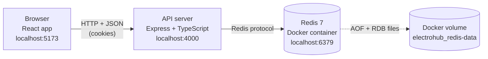
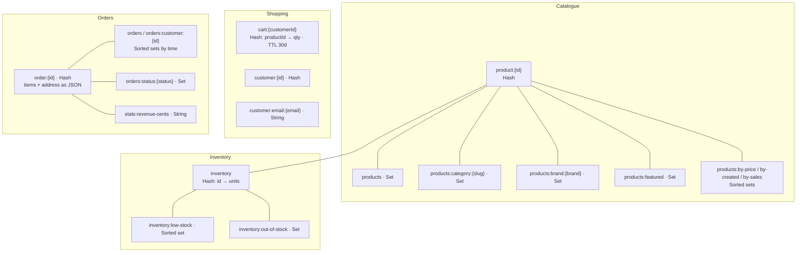
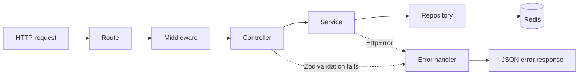
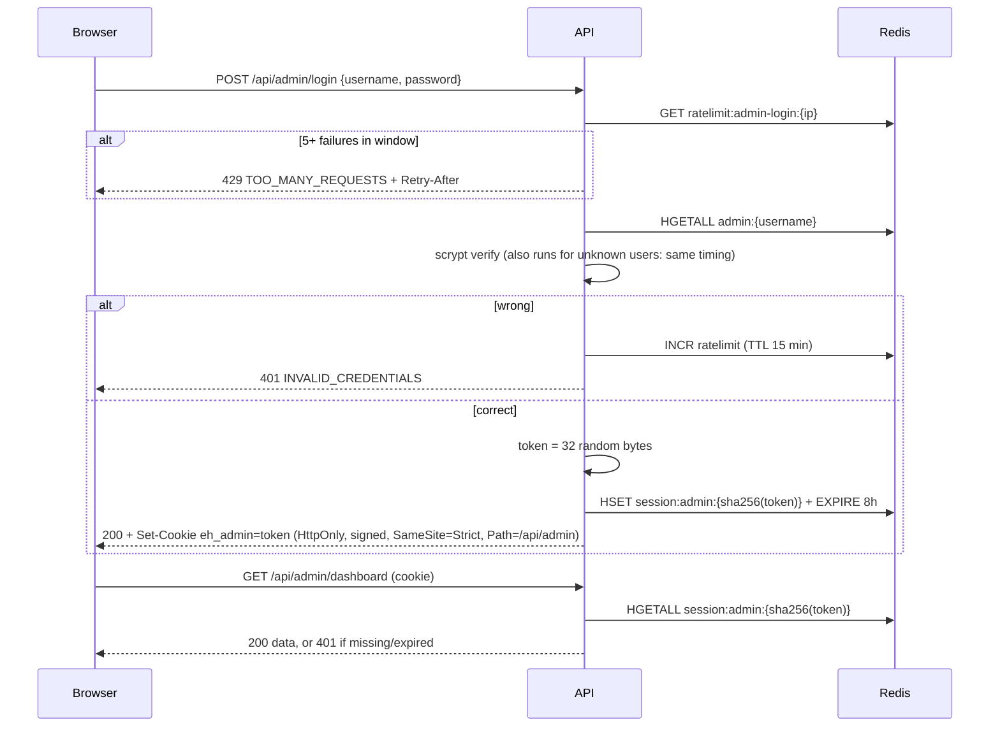
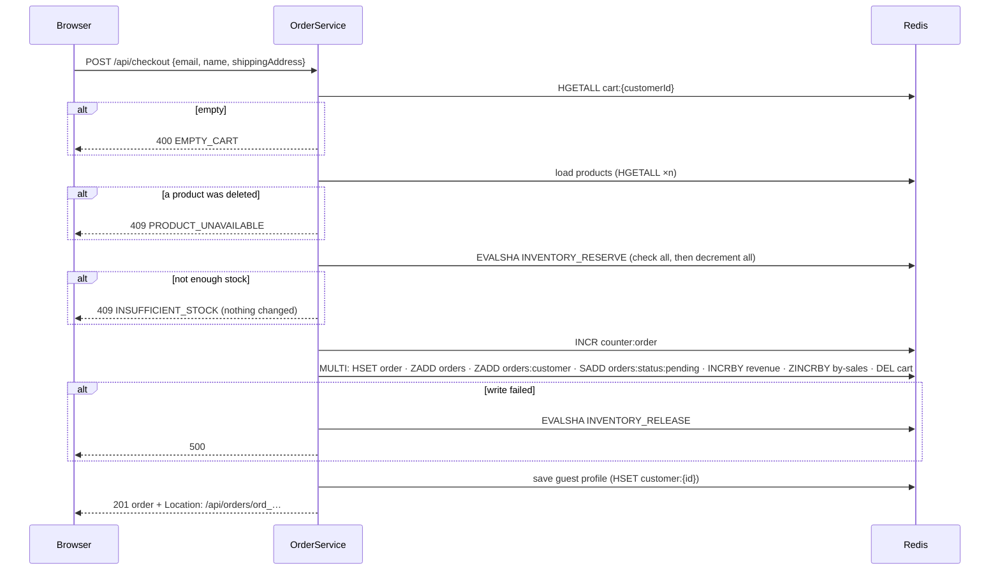
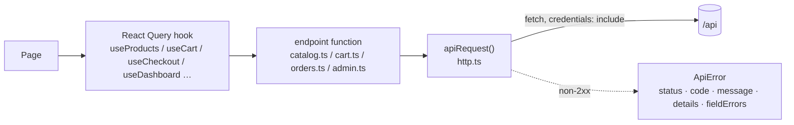

# ElectroHub architecture

This is the guide to how ElectroHub works, from the browser to the database. Read it
before changing anything structural.

Related documents:

- [README](../README.md): setup, scripts, environment variables, the Redis key table.
- [API reference](API.md): every endpoint, request body, response and error code.
- [Component library](../client/src/components/README.md): every UI component and its props.

**Contents**

1. [The big picture](#1-the-big-picture)
2. [Repository map](#2-repository-map)
3. [Database: Redis](#3-database-redis)
4. [Backend: Express API](#4-backend-express-api)
5. [Key flows, step by step](#5-key-flows-step-by-step)
6. [Frontend: React app](#6-frontend-react-app)
7. [Testing](#7-testing)
8. [Configuration and scripts](#8-configuration-and-scripts)
9. [Limitations and gotchas](#9-limitations-and-gotchas)
10. [How to add a feature](#10-how-to-add-a-feature)
11. [Glossary](#11-glossary)

---

## 1. The big picture

ElectroHub is made of three parts, each with one responsibility:



| Part         | Folder               | Stack                                                                    | Responsibility                                                                                       |
| ------------ | -------------------- | ------------------------------------------------------------------------ | ---------------------------------------------------------------------------------------------------- |
| **Client**   | `client/`            | React 19, Vite, TypeScript, Tailwind CSS 4, TanStack Query, React Router | Draws the pages. Never touches the database.                                                         |
| **Server**   | `server/`            | Node.js, Express 5, TypeScript, Zod, official `redis` client             | Owns every business rule: prices, stock, permissions.                                                |
| **Database** | `docker-compose.yml` | Redis 7.4 Community Edition                                              | The only database. It stores products, stock, carts, customers, orders, admin accounts and sessions. |

**How the browser reaches the API.** In development the Vite dev server forwards every
`/api/...` request to port 4000 (see `client/vite.config.ts`). The browser only ever talks
to `localhost:5173`. Cookies are therefore first-party, and there is no cross-origin
complexity.

**Independent packages.** `server/` and `client/` each have their own `package.json`, and
each can be installed, run and tested on its own.

---

## 2. Repository map

```
electrohub/
├── docker-compose.yml          Redis 7 with AOF + RDB persistence and a healthcheck
├── .env.example                every setting, documented (copy to .env, never commit .env)
├── start.cmd                   Windows one-click launcher (Redis + API + website)
├── docs/
│   ├── API.md                  REST reference
│   └── ARCHITECTURE.md         this file
├── server/
│   ├── src/
│   │   ├── index.ts            entry point: connect Redis, listen, graceful shutdown
│   │   ├── app.ts              buildApp(): repositories → services → routes
│   │   ├── config.ts           loads and validates .env with Zod
│   │   ├── db/
│   │   │   ├── redis.ts        client factory, fail-fast connect, reconnect, close
│   │   │   ├── keys.ts         every Redis key name (single source of truth)
│   │   │   ├── scripts.ts      Lua scripts for multi-key atomic updates
│   │   │   ├── setup.ts        persistence check, schema version, reset
│   │   │   └── seed/           21 products, 3 demo customers (idempotent)
│   │   ├── repositories/       the ONLY code that sends Redis commands
│   │   ├── services/           business rules (catalog, cart, orders, auth, dashboard)
│   │   ├── controllers/        HTTP in/out: validate, call a service, respond
│   │   ├── routes/             URL → controller (catalog, shop, admin, health)
│   │   ├── middleware/         customer cookie, admin guard, error handler
│   │   ├── schemas/            Zod schemas: domain (product, order…) + HTTP (api.ts)
│   │   ├── lib/                crypto (scrypt, tokens), cookies, HttpError, logger
│   │   └── types/              Express request augmentation (req.customerId, req.admin)
│   ├── scripts/                db:setup, db:seed, db:reset, admin:create CLIs
│   └── tests/                  Vitest + Supertest, mostly against a real Redis
└── client/
    ├── index.html              applies the saved theme before first paint
    ├── vite.config.ts          dev proxy, aliases, test config
    └── src/
        ├── main.tsx            providers: React Query, theme, toasts, cart drawer
        ├── App.tsx             routes (admin + /design are lazy-loaded)
        ├── styles/             tokens.css (design values), theme.css (Tailwind map), index.css
        ├── api/                fetch wrapper, endpoint functions, React Query hooks
        ├── components/         ui/ · commerce/ · layout/ · admin/
        ├── pages/              store pages, admin/ pages, DesignPage (dev only)
        ├── hooks/              useAddToCartWithFeedback
        ├── store/              theme and cart-drawer context
        └── lib/                cn(), formatting, specs, orders, validation, product form
```

---

## 3. Database: Redis

### 3.1 Why Redis, and how it differs from SQL

Redis is a **key–value store**. There are no tables, rows, joins or SQL. Every piece of data
is stored under a **key** (a string name), and every key has a **data type**. ElectroHub uses
five types:

| Type                        | Mental model                                 | Used for                                                                              |
| --------------------------- | -------------------------------------------- | ------------------------------------------------------------------------------------- |
| **Hash**                    | a single row: field → value                  | a product, a customer, an order, the inventory, a cart                                |
| **Set**                     | an unordered bag of unique IDs               | category, brand and featured indexes; order status buckets                            |
| **Sorted set**              | IDs, each with a numeric score, kept ordered | price, newest and best-seller rankings; low-stock ranking; order history              |
| **String**                  | one value                                    | ID counters (`INCR`), the email → customer lookup, revenue total, rate-limit counters |
| **TTL** (expiry on any key) | auto-delete after N seconds                  | carts (30 idle days), admin sessions (8 h), login lockout window                      |

Redis is used **as the database, not a cache**. In practice that means three things:

- **Persistence is on.** `docker-compose.yml` starts Redis with `--appendonly yes
--appendfsync everysec`. Every write is appended to an AOF log, which is flushed to disk
  each second, so at most about 1 s of writes can be lost in a crash. RDB snapshots run as
  a second backup. The files live in the named Docker volume `electrohub_redis-data`, so
  they survive `docker compose restart` and `down`/`up`. `docker compose down -v` deletes
  them.
- **`npm run db:setup` checks persistence.** It warns if AOF is off and records
  `meta:schema-version`.
- **Every key is namespaced** with `REDIS_KEY_PREFIX` (default `electrohub:`), so
  `product:{id}` is stored as `electrohub:product:{id}`. Tests use
  `electrohub:test:{suite}:{pid}:` and delete their keys afterwards, so they never touch real
  data.

### 3.2 The data model

All names are defined in `server/src/db/keys.ts`. The keys group into one entity per
record, with index keys around it:



**Records (hashes)**

| Key                             | Fields                                                                                                                                                                   |
| ------------------------------- | ------------------------------------------------------------------------------------------------------------------------------------------------------------------------ |
| `product:{id}`                  | `id, name, brand, brandSlug, category, description, priceCents, specs` (JSON string), `imageUrl, featured` (`1`/`0`), `createdAt, updatedAt`                             |
| `inventory`                     | one field per product: `productId → units in stock`. **Stock lives only here**, not in the product hash.                                                                 |
| `customer:{id}`                 | `id, email, name, phone, address` (JSON), `createdAt, updatedAt`                                                                                                         |
| `cart:{customerId}`             | `productId → quantity`, plus a sliding 30-day TTL                                                                                                                        |
| `order:{id}`                    | `id, customerId, status, items` (JSON snapshot), `itemCount, subtotalCents, shippingCents, totalCents, shippingAddress` (JSON), `contact` (JSON), `createdAt, updatedAt` |
| `admin:{username}`              | `username, passwordHash` (scrypt), `createdAt, updatedAt`                                                                                                                |
| `session:admin:{sha256(token)}` | `username, createdAt, expiresAt`, plus a TTL equal to the session lifetime                                                                                               |

**Indexes**

| Key                          | Type       | Score / contents                     | Answers the question                     |
| ---------------------------- | ---------- | ------------------------------------ | ---------------------------------------- |
| `products`                   | Set        | all IDs                              | "every product"                          |
| `products:category:{slug}`   | Set        | IDs                                  | "all mice"                               |
| `products:brand:{brandSlug}` | Set        | IDs                                  | "everything by Logitech"                 |
| `products:featured`          | Set        | IDs                                  | "featured products"                      |
| `products:by-created`        | Sorted set | created-at (ms)                      | "newest first"                           |
| `products:by-price`          | Sorted set | price (cents)                        | "cheapest first", "between $40 and $500" |
| `products:by-sales`          | Sorted set | units sold                           | "best sellers"                           |
| `inventory:low-stock`        | Sorted set | stock (only ≤ `LOW_STOCK_THRESHOLD`) | "what needs restocking, lowest first"    |
| `inventory:out-of-stock`     | Set        | IDs with 0 units                     | "what can't be sold"                     |
| `customer:email:{email}`     | String     | customer ID                          | "is this email taken?"                   |
| `orders`                     | Sorted set | placed-at (ms)                       | "all orders, newest first"               |
| `orders:customer:{id}`       | Sorted set | placed-at (ms)                       | "this shopper's history"                 |
| `orders:status:{status}`     | Set        | order IDs                            | "all paid orders"                        |

**Counters and system keys**

| Key                                 | Purpose                                                                      |
| ----------------------------------- | ---------------------------------------------------------------------------- |
| `counter:order`, `counter:customer` | `INCR` sequences that become `ord_000001`, `cus_000001`                      |
| `stats:revenue-cents`               | revenue of non-cancelled orders (increased at checkout, decreased on cancel) |
| `ratelimit:admin-login:{ip}`        | failed-login counter with a 15-minute TTL                                    |
| `meta:schema-version`               | data-model version written by `db:setup`                                     |

### 3.3 Querying without SQL

Redis can't run `SELECT … WHERE category = 'mice' ORDER BY price`, so the **indexes are
maintained by hand** on every write. Reads combine them. `ProductRepository.list()` takes
one of two paths:

- **No filters (fast path).** One command reads a page straight out of the sort index:
  `ZRANGE products:by-created 0 19 REV`.
- **With filters.**
  1. Get the candidate IDs by intersecting the filter sets:
     `SINTER products:category:mice products:brand:logitech` (or a price range with
     `ZRANGE products:by-price 4000 50000 BYSCORE`).
  2. Optional `inStock`: one `HMGET inventory id1 id2 …` drops products with 0 units.
  3. Optional `q` search: `HMGET` name, brand and category for each candidate, and keep
     those containing every word.
  4. Sort: `ZMSCORE <sort index> id1 id2 …` returns each candidate's score in one round trip.
  5. Slice out the requested page, then load those products (`HGETALL` per product plus
     one `HMGET` on `inventory`).

Application code **never scans the keyspace** (`KEYS` or `SCAN`). Only the admin `db:reset`
script uses `SCAN`.

### 3.4 Atomicity: Lua scripts and MULTI

Many operations change several keys at once. Creating a product touches its hash, the
inventory, and up to 8 indexes. If the process died halfway, the indexes would disagree
with the data. ElectroHub uses two Redis features to prevent that.

**Lua scripts** (`server/src/db/scripts.ts`). Redis runs a script as one isolated step: no
other command runs until it finishes. Scripts are called with `EVALSHA`, falling back to
`EVAL` on `NOSCRIPT`.

| Script                                                    | What it guarantees                                                                                                                                                              |
| --------------------------------------------------------- | ------------------------------------------------------------------------------------------------------------------------------------------------------------------------------- |
| `PRODUCT_CREATE`                                          | refuses duplicates; writes the hash, stock and all indexes together                                                                                                             |
| `PRODUCT_UPDATE`                                          | reads the **stored** category and brand first, then moves the product between indexes. Two simultaneous edits can't leave it in two categories.                                 |
| `PRODUCT_DELETE`                                          | removes the hash, stock and every index entry                                                                                                                                   |
| `INVENTORY_SET` / `INVENTORY_ADJUST`                      | changes stock and keeps `low-stock` / `out-of-stock` in sync; never goes below 0                                                                                                |
| `INVENTORY_RESERVE`                                       | checkout. Checks **every** line, and only if all have enough stock decrements them all. All or nothing. 20 simultaneous buyers of 1 unit gives exactly 1 success (tested).      |
| `INVENTORY_RELEASE`                                       | returns stock (failed checkout, cancellation); skips deleted products                                                                                                           |
| `CUSTOMER_CREATE` / `CUSTOMER_UPDATE` / `CUSTOMER_DELETE` | `SET … NX` claims the email, so two sign-ups can't share one                                                                                                                    |
| `ORDER_SET_STATUS`                                        | checks the transition is allowed, moves the order between `orders:status:*` sets, and on cancel reverses revenue and best-seller counts. Concurrent cancels can't double-count. |

**MULTI/EXEC transactions** queue commands and apply them together. They're used when no
read-then-decide is needed: creating an order, updating a cart (`HINCRBY` + `EXPIRE`),
admin sessions (`HSET` + `EXPIRE`), and the rate-limit counter.

> The scripts build index key names from the prefix inside Lua. That's correct on a
> single Redis server (what ElectroHub uses) but would need hash tags on Redis Cluster.

### 3.5 Seed data

`npm.cmd --prefix server run db:seed` (`server/src/db/seed/`) loads **21 products**, 3 in each
of 7 categories (gaming laptops, laptops, PCs, mice, monitors, headphones, microphones), and
3 demo customers.

- **Idempotent.** Products have fixed IDs. A product that already exists is compared and
  only updated if it changed. Current stock is kept unless you run
  `db:seed -- --reset-stock`.
- **Edge cases on purpose.** `msi-katana-15-b13v` has **0 units** (out of stock), and
  `lenovo-thinkpad-x1-carbon-gen12` has **exactly 1** (last-unit race).

---

## 4. Backend: Express API

### 4.1 Layers



| Layer      | Folder          | Rule of thumb                                                        | Example                                                                  |
| ---------- | --------------- | -------------------------------------------------------------------- | ------------------------------------------------------------------------ |
| Route      | `routes/`       | URL and HTTP method only                                             | `router.post('/checkout', session, orderC.checkout)`                     |
| Middleware | `middleware/`   | cross-cutting concerns                                               | `customerSession` sets `req.customerId`; `requireAdmin` sets `req.admin` |
| Controller | `controllers/`  | parse input with Zod, call **one** service, send `{ data }`          | `checkoutBody.parse(req.body)`                                           |
| Service    | `services/`     | business rules; may combine repositories                             | checkout = reserve → create order → release on failure                   |
| Repository | `repositories/` | the **only** place with Redis commands; owns key names and atomicity | `inventory.reserve(lines)`                                               |

`app.ts` wires everything together in `buildApp({ config, redis })`. Dependencies are
passed in rather than imported globally, which is what lets the tests run the real app
against an isolated key prefix.

### 4.2 Startup and shutdown (`server/src/index.ts`)

1. **Load configuration.** `config.ts` reads `.env` (repository root, or `server/.env` if
   present) and validates it with Zod. Invalid values stop the process with a readable
   list of problems. In production it also refuses to start without a 32+ character
   `COOKIE_SECRET`.
2. **Connect to Redis.** `getRedisClient()` connects and `PING`s.
   - **Startup:** the initial connection is retried 5 times, then the process exits with
     _"Is Redis running? Try `docker compose up -d redis`"_.
   - **Later drops:** it reconnects forever with back-off from 100 ms up to 5 s.
3. **Listen.** Build the app and listen on `PORT` (4000).
4. **Shut down cleanly.** On SIGINT or SIGTERM it stops accepting requests, lets in-flight
   ones finish, closes Redis with `QUIT`, and exits. After 10 s it force-exits.

### 4.3 Request handling details

- **Global middleware (in order):** Helmet security headers, CORS (only `CORS_ORIGIN`,
  credentials allowed), JSON body parser (100 kB limit), cookie parser (signed with
  `COOKIE_SECRET`).
- **Validation:** every body, query string and route parameter goes through a Zod schema
  in `schemas/api.ts`. Query strings arrive as strings, so the schemas coerce numbers and
  booleans (`"true"` → `true`).
- **Responses:** single resources are `{ "data": … }`. Collections are
  `{ "data": [...], "pagination": { page, limit, total, totalPages } }`.
- **Errors:** services throw `HttpError(status, message, code, details?)`. The error handler
  (`middleware/errorHandler.ts`) turns every failure into the same shape:

  ```json
  {
    "error": {
      "code": "INSUFFICIENT_STOCK",
      "message": "Not enough stock for \"laptop-a\"",
      "details": { "productId": "laptop-a", "requested": 1, "available": 0 }
    }
  }
  ```

  It maps:
  - Zod failures to `400 VALIDATION_ERROR`, with `details: [{ path, message }]`;
  - malformed JSON to `400 BAD_JSON`;
  - oversized bodies to `413 PAYLOAD_TOO_LARGE`;
  - anything unexpected to a generic `500 INTERNAL`. The real error is logged on the
    server and never sent to the client.

### 4.4 Identity, sessions and security

**Shoppers (no account in v1).** `middleware/customerSession.ts` runs on every cart,
checkout and order route.

1. It reads the `eh_customer` cookie. If the cookie is missing, unsigned, tampered with or
   malformed, it generates `cus_` + 24 random hex characters.
2. It sets the cookie:
   - **HttpOnly:** JavaScript can't read it.
   - **Signed:** with `COOKIE_SECRET`, so it can't be forged.
   - **SameSite=Lax:** not sent on cross-site POSTs.
   - **Path=/api**, valid for 1 year, and **Secure** in production.
3. Carts and orders are keyed by that ID. Requesting another shopper's order returns
   `404`, the same as a missing one, so order IDs can't be probed.

**Administrators** (`services/authService.ts`, `middleware/adminAuth.ts`):



- **Passwords:** stored only as **scrypt** hashes
  (`scrypt$N$r$p$salt$hash`, compared in constant time).
- **Tokens:** Redis stores only the **SHA-256 of the token**, so a leaked database dump
  can't be replayed as a login.
- **Logout** deletes the session key. The 8-hour TTL removes stale sessions automatically.
- **Error responses:** a wrong password and an unknown username give the identical
  response.
- **No secrets in responses:** admin responses are `Cache-Control: no-store`, and no
  response ever contains a password or hash.

### 4.5 Business rules

| Rule                                                                                                                  | Where                                    |
| --------------------------------------------------------------------------------------------------------------------- | ---------------------------------------- |
| Money is **integer cents** everywhere (`189900` = $1,899.00); no floats                                               | all schemas                              |
| Shipping is free at or above `FREE_SHIPPING_THRESHOLD_CENTS` ($100), otherwise `SHIPPING_FLAT_CENTS` ($9.99)          | `services/pricing.ts`                    |
| Adding to the cart **checks** stock for quick feedback but does **not** reserve it                                    | `services/cartService.ts`                |
| Stock is **reserved atomically at checkout**, all lines or none                                                       | `INVENTORY_RESERVE`                      |
| Order names and prices are **snapshotted** at checkout                                                                | `services/orderService.ts`               |
| Status flow `pending → paid → shipped → delivered`; `pending`/`paid` → `cancelled`; delivered and cancelled are final | `schemas/order.ts` `ORDER_TRANSITIONS`   |
| Cancelling returns stock and reverses revenue and best-seller counts                                                  | `ORDER_SET_STATUS` + `inventory.release` |
| Low stock means ≤ `LOW_STOCK_THRESHOLD` (5)                                                                           | `inventory:low-stock`                    |
| Carts expire after `CART_TTL_DAYS` (30) without changes                                                               | `cartRepository.ts`                      |

### 4.6 Endpoint overview

| Area      | Endpoints                                                                                                                                                                                                                                                |
| --------- | -------------------------------------------------------------------------------------------------------------------------------------------------------------------------------------------------------------------------------------------------------- |
| Catalogue | `GET /api/products` (`q`, `category`, `brand`, `minPriceCents`, `maxPriceCents`, `inStock`, `featured`, `sort`, `page`, `limit`), `GET /api/products/:id`, `GET /api/products/featured`, `GET /api/products/category/:category`, `GET /api/categories`   |
| Cart      | `GET /api/cart`, `DELETE /api/cart`, `POST /api/cart/items`, `PUT /api/cart/items/:productId`, `DELETE /api/cart/items/:productId`                                                                                                                       |
| Orders    | `POST /api/checkout`, `GET /api/orders`, `GET /api/orders/:id`, `POST /api/orders/:id/cancel`                                                                                                                                                            |
| Admin     | `POST /api/admin/login`, `POST /api/admin/logout`, `GET /api/admin/me`, `GET /api/admin/dashboard`, `POST/PUT/DELETE /api/admin/products(/:id)`, `GET /api/admin/orders(/:id)`, `PUT /api/admin/orders/:id/status`, `GET /api/admin/inventory/low-stock` |
| Health    | `GET /api/health`: `200` if Redis answers `PING`, otherwise `503`                                                                                                                                                                                        |

Full request and response details are in [API.md](API.md).

---

## 5. Key flows, step by step

### 5.1 Browsing: "Mice, cheapest first, in stock"

1. The browser requests
   `GET /api/products?category=mice&sort=price-asc&inStock=true`.
2. The controller validates the query (an unknown category or sort gets a 400).
3. `CatalogService.listProducts`, then `ProductRepository.list`:
   - `SMEMBERS products:category:mice`;
   - `HMGET inventory …` to drop out-of-stock products;
   - `ZMSCORE products:by-price …` to sort ascending;
   - slice the page, then `HGETALL product:{id}` for each.
4. The response is `{ data: [...], pagination: {...} }`.

### 5.2 Add to cart

1. `POST /api/cart/items {productId, quantity}`. The cookie identifies the shopper, or a
   new ID is issued.
2. `CartService.addItem`:
   - the product must exist (otherwise `404 PRODUCT_NOT_FOUND`);
   - it must be in stock (otherwise `409 OUT_OF_STOCK`);
   - the quantity already in the cart plus the new quantity must fit the stock (otherwise
     `409 INSUFFICIENT_STOCK`).
3. `MULTI: HINCRBY cart:{id} productId qty; EXPIRE cart:{id} 30d`.
4. The response is the full priced cart (prices and stock are re-read from Redis every time).

### 5.3 Checkout



### 5.4 Cancelling an order (shopper or admin)

1. `POST /api/orders/:id/cancel` (shopper; only their own order) or
   `PUT /api/admin/orders/:id/status {status:"cancelled"}`.
2. `ORDER_SET_STATUS` runs atomically:
   - checks that the current status allows `cancelled`;
   - `SMOVE` between status sets;
   - `HSET status`;
   - `DECRBY` revenue;
   - `ZINCRBY -qty` on best sellers.
3. `INVENTORY_RELEASE` puts the units back, and the low-stock indexes update.
4. If two cancels race, only one passes the status check. The other gets a 409, so stock
   is returned once.

### 5.5 Admin edits a product

1. `PUT /api/admin/products/:id {category:"monitors", priceCents:4500, stock:0}`. The
   `requireAdmin` middleware has already checked the session.
2. `PRODUCT_UPDATE` moves the product from `products:category:mice` to
   `products:category:monitors`, updates `products:by-price`, and writes the hash.
3. `INVENTORY_SET` sets stock to 0. That adds the product to `inventory:low-stock` (score 0)
   and to `inventory:out-of-stock`.
4. Only the fields you send change. (A Zod 4 quirk used to reset `featured` and `specs` on
   partial updates; it's fixed and covered by a regression test.)

---

## 6. Frontend: React app

### 6.1 Stack and structure

- **UI:** React 19 + TypeScript, built by Vite.
- **Routing:** React Router (`App.tsx`). The admin console and `/design` are **lazy-loaded**,
  so shoppers don't download them.
- **Server data:** TanStack Query (caching, loading states, refetching).
- **Styling:** Tailwind CSS 4 driven entirely by design tokens.
- **Icons and fonts:** lucide-react icons; Inter and JetBrains Mono, self-hosted via
  `@fontsource`.

### 6.2 Design system

| File                | Role                                                                                                                                                                                                                                         |
| ------------------- | -------------------------------------------------------------------------------------------------------------------------------------------------------------------------------------------------------------------------------------------- |
| `styles/tokens.css` | **Every design value** as a CSS variable: colours for dark (default) and light themes, type scale, 4px spacing grid, radii, shadows, motion durations, breakpoints, z-layers. Text colours meet WCAG AA contrast.                            |
| `styles/theme.css`  | Maps tokens to Tailwind utilities (`bg-surface`, `text-fg-muted`, `border-border`, `rounded-lg`, `shadow-glow`, `duration-fast`…). **Tailwind's default palette is disabled**, so `bg-blue-500` doesn't exist. Only semantic tokens compile. |
| `styles/index.css`  | Base styles, the global `:focus-visible` ring, dialog and skeleton animations, `.eh-numeric` (mono, tabular figures for prices)                                                                                                              |

**Theming.** `ThemeProvider` (`store/theme.tsx`) sets `data-theme="dark" | "light"` on
`<html>` and saves the choice in `localStorage`. A small inline script in `index.html`
applies the saved theme **before** the first paint, so there's no flash. Because components
only reference variables, the whole UI re-colours instantly.

**Showcase.** `/design` (development only) shows every token in both themes side by side,
and every component with its variants, loading, disabled and validation states.

### 6.3 Components

Full documentation is in [client/src/components/README.md](../client/src/components/README.md).

| Folder      | Contents                                                                                                                                                                        |
| ----------- | ------------------------------------------------------------------------------------------------------------------------------------------------------------------------------- |
| `ui/`       | Button, ButtonLink, Input, Select, Textarea, Checkbox, Field, QuantityStepper, Card, Badge, Modal, Drawer, Toast, Table, Pagination, EmptyState, Skeleton, Spinner, Breadcrumbs |
| `commerce/` | ProductCard, ProductImage + ProductIllustration, Price, StockBadge, CartDrawer, OrderSummary, OrderStatusBadge, OrderProgress, OrderDetails                                     |
| `layout/`   | Layout (skip link, focus on navigation), Navbar (desktop nav + mobile drawer), CategoryMenu, SearchForm, ThemeToggle, Logo, Footer                                              |
| `admin/`    | AdminLayout (sidebar + auth guard), AdminPageHeader, StatCard, BarList, ProductForm, SpecsEditor                                                                                |

Design decisions worth knowing:

- **Modal and Drawer use the native `<dialog>`.** It provides a focus trap, Esc to close,
  an inert page behind, and focus returning to the opener, all free and accessible. Mark
  the preferred first focus with `data-autofocus`, not `autoFocus`: React doesn't render
  `autoFocus` as an attribute, so the dialog can't see it.
- **ProductImage** shows real photos with `object-contain`. Placeholder URLs (the seed
  uses `placehold.co`) or broken images fall back to a line-art illustration per category.
- **ProductCard** uses a "stretched link": the product name's link covers the whole card,
  so there's one tab stop per card plus a separate Add button.
- **Field** wires `<label for>`, `aria-describedby` (hint or error) and `aria-invalid`
  for every form control.

### 6.4 Data layer (`client/src/api/`)



- `apiRequest()` sends and receives JSON, always includes cookies, and throws `ApiError`
  for error responses. `error.fieldErrors` turns a `VALIDATION_ERROR` into
  `{ "shippingAddress.city": "…" }` for showing messages inline.
- **Query keys** are defined in one place per area (`queries.ts`, `orderQueries.ts`,
  `adminQueries.ts`).
- **Mutations update the cache with the server's response.** For example, add-to-cart
  writes the returned cart, so the navbar badge updates instantly. They also invalidate
  affected data: checkout refreshes cart, products and orders.
- **Use hook-level callbacks:** `useAddToCart({ onSuccess })`, not
  `mutate(vars, { onSuccess })`. TanStack Query can skip per-call callbacks when the
  observer is re-created, which silently swallowed toasts during development.
- **Expired admin sessions:** a global `QueryCache`/`MutationCache` handler in `main.tsx`
  catches any admin `401` and re-checks the session. `AdminLayout` then redirects to
  `/admin/login?next=<current page>`.

### 6.5 Pages and routes

| Route                                  | Page                            | Highlights                                                                                                                                          |
| -------------------------------------- | ------------------------------- | --------------------------------------------------------------------------------------------------------------------------------------------------- |
| `/`                                    | HomePage                        | hero with a featured product, category tiles with live counts, featured and best-seller rails                                                       |
| `/products`                            | ProductsPage                    | search (`?q=`), category chips, sort, in-stock filter, pagination. **All state lives in the URL**, so it's shareable and survives reload.           |
| `/products/:id`                        | ProductPage                     | image, specs table, quantity stepper, add to cart                                                                                                   |
| `/checkout`                            | CheckoutPage                    | contact and address form, client validation mirroring the server, server field errors inline, focus jumps to the first error, stock-conflict banner |
| `/orders`, `/orders/:id`               | OrdersPage, OrderPage           | history for this browser; confirmation banner (`?placed=1`), status tracker, cancel with confirmation                                               |
| `/admin/login`                         | AdminLoginPage                  | error and lockout messages, safe `?next=` redirect (admin paths only)                                                                               |
| `/admin`                               | AdminDashboardPage              | revenue, orders, customers and stock-alert tiles; orders by status; top sellers; recent orders; low stock; refreshes every 30 s                     |
| `/admin/orders`, `/admin/orders/:id`   | AdminOrdersPage, AdminOrderPage | status filters with counts; only allowed transitions are offered                                                                                    |
| `/admin/products`, `/new`, `/:id/edit` | AdminProductsPage, product form | search and filter; create and edit with a typed specs editor and a live card preview; delete with confirmation                                      |
| `/admin/inventory`                     | AdminInventoryPage              | low-stock ranking with restock on the page                                                                                                          |
| `/design`                              | DesignPage                      | development only                                                                                                                                    |

### 6.6 Accessibility

- **Semantic elements:** real buttons, links, labels, `<nav>`, `<table>` with captions and
  `scope`, `<dialog>`.
- **Focus:** a "Skip to content" link, focus moves to `<main>` on navigation, and a
  visible focus ring everywhere.
- **Screen readers:** form errors are linked to their inputs, toasts use
  `role="status"`/`"alert"`, and the order tracker announces completed and current steps.
- **Meaning never by colour alone:** "Out of stock", "Only 2 left" and status badges are
  text.
- **Motion:** `prefers-reduced-motion` sets motion durations to 0.
- **Verified:** no horizontal scrolling at 375, 768 and 1440px, one `<h1>` per page, and an
  accessible name on every control.

---

## 7. Testing

| Suite                                                        | Tool                             | Count            | What it covers                                                                                          |
| ------------------------------------------------------------ | -------------------------------- | ---------------- | ------------------------------------------------------------------------------------------------------- |
| `server/tests/api/`                                          | Vitest + Supertest               | endpoint tests   | every endpoint, validation failures, cookie flags, admin auth and lockout, checkout races, cancellation |
| `server/tests/repositories/`                                 | Vitest                           | repository tests | index maintenance, concurrent edits, last-unit reservation, unique emails, order transitions            |
| `server/tests/seed.test.ts`, `config.test.ts`, `app.test.ts` | Vitest                           |                  | seed idempotency, config parsing, error format and HTTP hygiene (no Redis needed)                       |
| `client/src/**/*.test.ts(x)`                                 | Vitest + Testing Library (jsdom) | 34               | components, accessibility behaviour, form validation, cents conversion, dashboard bars                  |

In total there are **119 server tests** and **34 client tests**.

- **Real Redis, isolated prefix:** the Redis tests use the real Redis under
  `electrohub:test:{suite}:{pid}:` and delete their keys afterwards.
- **When Redis is down:** those tests are skipped automatically; set `REQUIRE_REDIS=1` (for
  example in CI) to make that a failure.
- **Run everything** from the repository root: `npm.cmd test`.

---

## 8. Configuration and scripts

**Configuration.** Everything is in `.env` at the repository root; `.env.example` documents
every value. The server, the client (Vite) and Docker Compose all read it. Only `VITE_*`
variables reach the browser.

> ⚠ Don't put `NODE_ENV` in `.env`. Vite reads the file too, and `NODE_ENV=development`
> makes `vite build` produce a development bundle. Production hosts set
> `NODE_ENV=production` in the real environment.

**Scripts** (Windows: always `npm.cmd`, run from the repository folder):

| Task                          | Command                                                                                            |
| ----------------------------- | -------------------------------------------------------------------------------------------------- |
| Start everything              | double-click `start.cmd`                                                                           |
| Start Redis only              | `docker compose up -d redis`                                                                       |
| API / website dev servers     | `npm.cmd --prefix server run dev` · `npm.cmd --prefix client run dev`                              |
| Check persistence and schema  | `npm.cmd --prefix server run db:setup`                                                             |
| Load the catalogue            | `npm.cmd --prefix server run db:seed` (`-- --reset-stock` to reset stock)                          |
| Wipe all data (development)   | `npm.cmd --prefix server run db:reset -- --yes`                                                    |
| Create or rotate the admin    | set `ADMIN_USERNAME` / `ADMIN_PASSWORD` in `.env`, then `npm.cmd --prefix server run admin:create` |
| Lint, type-check, test, build | `npm.cmd run lint` · `npm.cmd run typecheck` · `npm.cmd test` · `npm.cmd run build`                |
| Inspect Redis                 | `docker exec -it electrohub-redis redis-cli` (sample commands in the README)                       |

---

## 9. Limitations and gotchas

| Topic               | Detail                                                                                                                                                                                          |
| ------------------- | ----------------------------------------------------------------------------------------------------------------------------------------------------------------------------------------------- |
| Payments            | None. Orders start `pending`, and an admin marks them `paid`. The checkout page says so.                                                                                                        |
| Customer accounts   | None in v1. Orders belong to the browser's signed cookie. Clearing cookies hides them from the shopper, but they remain in Redis and admins can see them.                                       |
| Search              | Linear in the filtered candidates, which is fine for hundreds of products. A large catalogue needs a word index or RediSearch.                                                                  |
| Redis Cluster       | Not supported as-is: the Lua scripts derive keys inside the script.                                                                                                                             |
| Low-stock threshold | Mirrored in the client (`StockStatus.tsx`, 5) and on the server (`LOW_STOCK_THRESHOLD`). Change both. The same applies to the free-shipping threshold (`CartDrawer.tsx`).                       |
| Windows             | Use `npm.cmd` (PowerShell blocks `npm.ps1`). `cd` into the repository first. Batch files must keep CRLF line endings (set in `.gitattributes`).                                                 |
| Rolldown pin        | `vite@8.3.6` and `rolldown@1.2.16` are pinned via `overrides`, because Windows Smart App Control blocked a newer native binary. Remove the overrides once newer binaries load on every machine. |
| OneDrive            | If the project lives in a OneDrive folder, exclude `node_modules` from syncing. `.env` syncs too, so keep it private.                                                                           |

---

## 10. How to add a feature

Example: product reviews.

1. **Keys:** add names to `server/src/db/keys.ts`, for example `reviews:{productId}` (a
   sorted set by time) and `review:{id}` (a hash).
2. **Schema:** add a Zod schema to `server/src/schemas/` (rating 1–5, text length).
3. **Repository:** create `server/src/repositories/reviewRepository.ts`, the only file with
   review Redis commands. Use a Lua script or `MULTI` when several keys must change
   together. Register it in `repositories/index.ts`.
4. **Service:** create `server/src/services/reviewService.ts` for the rules (one review per
   customer per product, only after purchase…). Register it in `services/index.ts`.
5. **HTTP:** add the controller, the route, and the request schema in `schemas/api.ts`.
   Document the endpoint in `docs/API.md`.
6. **Server tests:** add them in `server/tests/api/` using `openTestApp()`.
7. **Client data:** an endpoint function in `client/src/api/`, a React Query hook, and the
   response type in `api/types.ts`.
8. **UI:** build it from existing components and tokens (no raw colours). Check it on
   `/design`, at 375px, and in both themes.
9. **Verify:** run `npm.cmd run lint`, `npm.cmd run typecheck` and `npm.cmd test` before
   opening a pull request.

---

## 11. Glossary

| Term                                    | Meaning                                                                                             |
| --------------------------------------- | --------------------------------------------------------------------------------------------------- |
| **AOF**                                 | Append-only file: Redis logs every write to disk (here, flushed every second).                      |
| **RDB**                                 | A point-in-time snapshot of the whole database.                                                     |
| **Hash / Set / Sorted set**             | Redis data types: a record, an unordered unique list, a list ordered by a numeric score.            |
| **TTL**                                 | Time to live: Redis deletes the key automatically when it expires.                                  |
| **Lua script**                          | Code that Redis runs atomically on the server, used to update a record and its indexes as one step. |
| **MULTI/EXEC**                          | A Redis transaction: queued commands applied together.                                              |
| **Index**                               | A Set or Sorted set kept up to date by hand so queries don't scan everything.                       |
| **Repository / Service / Controller**   | Data access / business rules / HTTP handling (see §4.1).                                            |
| **Zod**                                 | TypeScript library that validates data and infers its types.                                        |
| **TanStack Query**                      | React library for fetching, caching and refreshing server data.                                     |
| **Design token**                        | A named design value (colour, spacing…) stored as a CSS variable.                                   |
| **HttpOnly / SameSite / signed cookie** | Cookie protections: not readable by JavaScript / not sent cross-site / tamper-evident.              |
| **scrypt**                              | A deliberately slow password-hashing function.                                                      |
